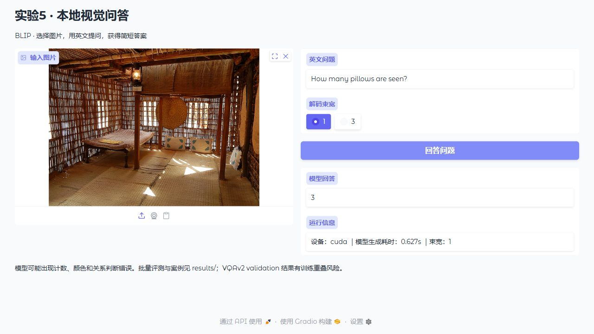

# 实验5：视觉问答系统（Windows / 本地 GPU）

人工智能算法综合课程设计。从原 Colab notebook 整理为独立可复现项目：数据准备 → 预训练推理 → 对照实验 → 官方/规范评测 → 图表与案例 → 本地交互演示。

**项目贡献是本地系统实现、评测修正、可复现对照与结果分析；预训练模型来自公开研究，没有声称自行训练模型或提出新架构。**

## 本机直接使用

在此文件所在目录打开PowerShell：
```powershell
.\run.ps1 doctor
.\run.ps1 demo
```
浏览器访问 `http://127.0.0.1:7865`。初次使用会下载模型；后续复用本地models/。

## 新计算机安装

Python 3.11，建议NVIDIA显卡；本次验证设备为RTX 5060 Ti 8GB。CPU可用但速度较慢。两个项目各自提供安装脚本和依赖，克隆任意一个即可使用。本次机器为了节省磁盘使用父目录共享虚拟环境，run.ps1会自动寻找；新安装则使用项目自己的.venv。

```powershell
git clone https://github.com/Lawrenlcy/ai-course-experiment5-vqa.git
cd ai-course-experiment5-vqa
powershell -ExecutionPolicy Bypass -File setup.ps1
.\run.ps1 doctor
```

RTX 50系列使用CUDA 12.8 PyTorch。CPU机器可将setup.ps1中的PyTorch索引换为https://download.pytorch.org/whl/cpu。Linux使用同版本Python，创建venv并按requirements.txt安装，运行下方python命令即可。

## 重现实验

```powershell
.\run.ps1 prepare --n 500 --seed 42
.\run.ps1 run --manifest data/manifest_n500_seed42.json --out results/reproduction
```

对应通用命令为 `python -m vqa_lab prepare` 和 `python -m vqa_lab run`。减少样本数可快速验证，例如prepare --n 8，再明确传入对应manifest并使用新输出目录。中断后使用完全相同命令可续跑；更改模型、配置、样本或源码后应使用新输出目录，避免结果混合。模型下载使用首次解析的固定Hub提交，记录在models/*.json和run_config.json中。

默认规模：500道VQAv2题，greedy/beam3/灰图3种设置，共1500条回答。

## 已有结果与报告素材

阅读 [本地结果分析](results/local500/RESULTS.md)、[方法与引用](docs/REFERENCES.md)、[实验协议](docs/EXPERIMENT_PROTOCOL.md) 和 [AI Agent使用记录](docs/AI_AGENT_LOG.md)。

- `results/local500/`：本机运行配置、环境、逐条结果、汇总、置信区间和PNG/SVG图。
- `assets/`：精选演示材料和界面截图。
- `docs/legacy_colab_source.ipynb`：去除输出后的旧版源码，仅供历史追溯，不是本地入口。
- `tests/`：官方VQA留一法、答案规范化、缺漏/重复预测校验。
- `data/`、`models/`：自动下载并在本机缓存，不提交Git。
- `docs/素材使用指南.md`：报告章节与PPT页面对应的素材。

完整音频/数据缓存体积较大，本地成果包另行保留；仓库提供重建脚本和精选素材，模型与完整数据集不放入Git。

## 评价边界

官方BLIP训练配置包含vqa_val，当前VQAv2验证子集可能与训练数据重叠。结果只能称验证集诊断，不能称独立测试泛化准确率。灰图干预是分布外消融，不是重新训练的纯文本基线。

## 测试
```powershell
python -m pytest -q
```

## 许可与致谢

原创代码为MIT。模型、数据、引用源码各遵循自身许可，详见docs/REFERENCES.md与third_party/。BLIP模型为BSD-3-Clause；COCO图像来自各原始作者，示例仅用于研究分析并保留图像ID与来源。

## 结果解读与演示截图

[本次结果的具体解读](docs/RESULT_INTERPRETATION.md)包含配对区间与局限。完整结果包可从[Releases](https://github.com/Lawrenlcy/ai-course-experiment5-vqa/releases)下载。



离线运行前先完成模型下载，然后设置 `$env:HF_HUB_OFFLINE="1"`。精确依赖版本见requirements-lock.txt；setup.ps1先安装PyTorch，再安装此锁定文件。
